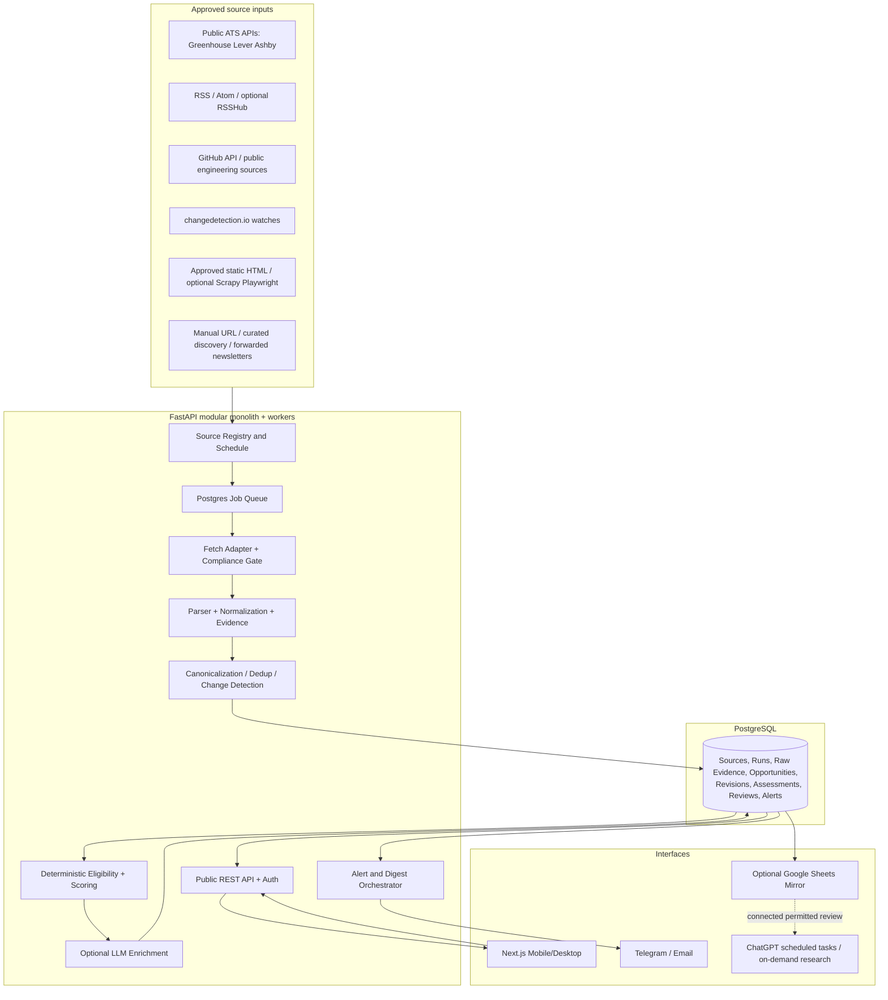

# DISCMON — Product Requirements & Engineering Specification

**Version:** 1.0 | **Prepared:** 28 October 2026 | **Status:** Build specification, not implemented application  
**Owner profile:** One India-based early-career software engineer, no longer a student, preparing for an IDFC FIRST Bank engineering role.  
**Primary objective:** Discover unusual, high-quality career and builder opportunities *before* their preparation and application windows, with minimal ongoing user attention.

> **Instruction to implementation agent:** Treat this document as the product and technical contract. Implement incrementally; do not silently replace technologies, promise unsupported ChatGPT integrations, invent external source capabilities, or skip tests. Verify dependency versions, API response structures, website access policies and licenses at implementation time.

---

## 0. Executive decision

Build an **independently operable, privacy-oriented, single-user hybrid career intelligence system**. Reuse mature open-source collectors and monitors; write a modular Python ingestion/evaluation engine; store records in PostgreSQL; present them in a responsive Next.js app. ChatGPT is an optional interaction/research layer, **not** a dependency for basic operation.

**Core:** Next.js 16 + TypeScript + Tailwind + shadcn/ui + TanStack Table; FastAPI + Pydantic v2 + SQLAlchemy 2 + Alembic; PostgreSQL 18; APScheduler (scheduler process) + PostgreSQL queue (worker process); httpx + feedparser + BeautifulSoup/selectolax; official job APIs; GitHub API; changedetection.io; optionally RSSHub and Scrapy; Playwright only where permitted and needed; pytest + Playwright E2E; Docker Compose; private access via Tailscale (default for hosted personal deployment).

**Not in v1:** Microservices, Kubernetes, Celery/Redis, Elasticsearch, vector database, event streaming, automatic job applications, unauthorized LinkedIn/Indeed scraping, an arbitrary ChatGPT-conversation webhook, a paid LLM requirement, scraping gated sites, broad multiuser SaaS, AI autonomous sending of emails/applications.

### 0.1 Problem definition
- P1: Rare programmes and unusual hiring channels go unnoticed.
- P2: Discovery frequently happens too late to prepare.
- P3: Public data mixes eligible/ineligible roles, uncertain compensation and contradictory claims.
- P4: Multiple job boards/newsletters create duplicate alerts and unmanageable noise.
- P5: Research, reviews, deadlines and decisions are not retained in one searchable place.
- P6: The user wants to prioritize IDFC preparation and high-value skill development, not incessant browsing.

### 0.2 Success outcomes (operational targets, not guarantees)
- At least 30 approved, heterogeneous sources monitored after initial onboarding; sources can grow without code changes for supported source types.
- Detect material changes to approved sources within 24 hours of a *successful permitted check* in normal operation; 95% within 24 hours for daily sources. No guarantee of detecting everything on the internet.
- No repeat alert for a previously sent unchanged opportunity.
- Zero student-only opportunities marked "Eligible".
- Every important opportunity carries a primary URL, evidence timestamp, and explicit eligibility/confidence markers.
- Typical daily user attention: 0–5 minutes; weekly review: 20–40 minutes.
- Browser usable from phone and laptop; full export and backups.
- System works without an LLM key and without ChatGPT.

### 0.3 Non-goals
- Exhaustive coverage of all websites or private/social-network content.
- Guarantee of recruitment outcomes, advertised salaries, or deadlines.
- Access to nonpublic recruiter networks, invite-only postings, or internal job boards.
- Use of credentials from websites unless the user explicitly authorizes compatible, compliant connectors.
- Fully autonomous job applications or messages to people.

---

## 1. Product identity, audience and profile

**Working name:** DiscMon. **Tagline:** *Discover early. Prepare deliberately.*

Single owner profile with versioned preferences:
- Employment stage: `prejoin` until joining IDFC, then `employed`; **not an enrolled student**.
- Student-only: hard exclude. Graduation-year-only 2027 intake: hard exclude unless explicitly proven open to nonstudents.
- Location: India; remote-from-India eligible or explicit India onsite; relocation opportunities permitted but separately classified and opted into.
- Specialisms: backend, distributed systems, cloud/platform/SRE, databases/storage/networking, security infrastructure, applied AI/ML infrastructure and high-leverage open source.
- Career stage: entry/early-career now; forward preparation for 1–3 years experience.
- Domains: technical fellowships/residencies; rare professional programmes; selectively global hiring; open-source mentorships/grants; developer and infrastructure companies; selective hackathons; speaking/mentoring and founder networks (optional low priority).
- Exclude: paid-to-apply scams, student-only, unverifiable opportunities with no primary source, generic mass job advertisements, out-of-country jobs without workable authorization (unless marked "relocation research"), low-signal participation events.
- Alert posture: immediate **only** rare/high-confidence/high-impact findings or truly urgent deadlines; otherwise daily/weekly digest.
- Time budget: preserve IDFC preparation. Opportunities requiring full-time career interruption get a clear `employment_conflict` warning and are NOT routine recommendations.
- Future-proof: preferences stored in DB and editable; no eligibility rules buried in prompts.

---

## 2. Technology choices and trade-offs

| Part | Selected | Role | Decision rationale |
|---|---|---|---|
| UI | Next.js 16 App Router, React 19, TypeScript, Tailwind, shadcn/ui, Lucide | Responsive product | Mature app ecosystem and highly reusable components |
| UI data | TanStack Query, TanStack Table, Zod, React Hook Form | Fetch, tables, validated forms | Keep state and validation explicit |
| Charts | Recharts (small set) | Coverage, relevance and source reliability trends | Avoid dashboard bloat |
| API | FastAPI, Pydantic v2 | OpenAPI REST, authorization, filtering, exports | Python suits crawling/data work |
| Persistence | PostgreSQL 18, SQLAlchemy 2, Alembic | Durable source of truth, migrations | Transactions, JSONB, indexed search |
| Queue | Postgres `jobs` table with `FOR UPDATE SKIP LOCKED` | Retryable ingest pipeline | Avoid premature broker/Redis complexity |
| Scheduler | APScheduler in one elected process, Postgres advisory lock | Enqueue due source checks | Scheduler never performs long crawls directly |
| HTTP/RSS | httpx, feedparser, selectolax/BeautifulSoup | Requests, feeds and static-page parsing | Fast and simple |
| Job APIs | Official public Greenhouse, Lever, Ashby adapters | Collect published jobs | Structured fields and identifiers |
| Source changes | changedetection.io, Apache-2.0 | Track selected official announcement pages | Mature watch engine + API/webhook; not a canonical database |
| Feed route expansion | RSSHub, AGPL-3.0, **optional separate service** | Create feeds for supported sites | Useful but resource- and maintenance-sensitive; obey routes' site constraints |
| Large crawling | Scrapy, BSD-3-Clause, optional | Multi-page legal public sites | Do not run for sites with reliable APIs |
| JS fallback | Playwright | Dynamic HTML when allowed | Browser only as an explicit exception |
| GitHub | GitHub REST API with scoped token | Releases, issues, org activity, curated repositories | Observe published API limits |
| Search | PostgreSQL FTS + `pg_trgm` | Search and fuzzy dedupe | No Elasticsearch needed |
| AI | Local rules first; optional OpenAI-compatible provider adapter | Triage summaries and structured extraction | Runs without a paid LLM; human-verifiable output |
| Alerts | Telegram Bot API and/or SMTP + ChatGPT task digests | User notifications | Ordinary, reliable channels plus existing ChatGPT workflow |
| Sheet | Google Sheets API service account on explicitly shared tracker | Optional export/mirror | DB stays authoritative; Sheets failure must not block ingest |
| Access | Localhost for development; Tailscale Serve/private tailnet for hosting | Single-user security | Avoid exposed administrative UI; evaluate ChatGPT integration separately |
| Deploy | Docker Compose, pinned image versions, volumes, health checks | Local or one VPS | Simple to operate and audit |
| Monitoring | Structured JSON logs, admin health page, Prometheus metrics optional | Detect broken sources | Broken collectors must not silently imply no opportunities |

**Deliberately not primary:** n8n: personal self-hosting is allowed under a source-available, fair-code Sustainable Use License, but it is not OSI open source and would duplicate custom workflow logic. Huginn: excellent automation alternative but extra Ruby stack and duplicate workflow state. FreshRSS: good reader, but redundant with native feed ingest unless you want a personal reading app. SearXNG/Meilisearch/Redis/Temporal: unjustified complexity for one user.

**Version policy:** Prefer pinned stable supported major/minor versions, generate lockfiles; avoid `latest` container image tags in production; review upstream changes monthly.

### 2.1 Open-source integrations, boundaries
**changedetection.io:** configured with official announcement/fellowship pages and selectors that ignore decorative noise. It emits a webhook containing watch identifier and changed state. Our worker then refetches the authoritative page through compliant access and records evidence. Do not blindly trust a change notification as a confirmed application opening. API key held server-side. Alternatively poll its API when webhook unavailable. Never have both adapter and changedetection monitor the same content without source ownership and deduplication rules.

**RSSHub:** enable only vetted routes for relevant websites missing first-party feeds. Store feed URL, upstream page, route documentation, last success and trust. Do not treat an unofficial route as primary evidence; follow through to source announcement.

**Scrapy:** optional package for explicitly reviewed crawlers, each with robots/terms assessment, per-host rate limits, selectors, pagination limit, bounded crawl depth, tests and contact User-Agent. Never deploy generic internet-wide spiders.

**Playwright:** restricted JS rendering on approved domains, with outbound network controls; no CAPTCHA bypass, login/session evasion, stealth plugins or anti-bot proxy rotation.

---

## 3. System architecture



**One-way data authority:** Collector > DB > alerts/dashboard/Sheets. Human feedback > API > DB > future score rules. ChatGPT reports are analytical output and can recommend actions; only explicit authorized writes change DB.

### 3.1 Collection stages and contracts
1. **Discover:** locate candidate sources/opportunities via feeds, curated lists, public APIs, newsletters and (optional) search-provider API. New discovered domains go to *candidate-source approval* queue, not unrestricted crawls.
2. **Schedule:** due sources produce jobs with source ID, cursor, job type and stable idempotency key.
3. **Fetch:** domain-scoped, robots/terms-aware, retry with backoff, conditional HTTP GET (ETag/Last-Modified), validated content type and size, source timestamps and response metadata.
4. **Parse:** typed schema per adapter. Source text and exact fields preserved for provenance.
5. **Normalize:** title, organization, location, compensation, eligibility, dates, URLs and category; uncertainties retained.
6. **Deduplicate:** combine the same posting from different feeds using ATS ID or verified canonical URL; candidate matches by title/org/date require cautious merging and audit.
7. **Assess:** deterministic hard filters and rule scores; optional LLM only for text extraction or concise explanation, with evidence refs and schema validation.
8. **Detect change:** store revisions; compute material-field diff; distinguish new, updated, closed, reopened, unverified.
9. **Notify:** priority/urgency gate, notification history and quiet-hour rules; scheduled digests.
10. **Review:** user marks `watch`, `prepare`, `research`, `apply`, `ignore`, `completed`, etc.; preference feedback can adjust soft weights only.

### 3.2 Source adapter interface
Each adapter implements:
```python
class SourceAdapter(Protocol):
    kind: str
    async def discover(self, source: SourceConfig) -> list[DiscoveredURL]: ...
    async def fetch(self, source: SourceConfig, cursor: str | None) -> FetchResult: ...
    def parse(self, source: SourceConfig, result: FetchResult) -> list[NormalizedCandidate]: ...
```
`FetchResult` includes `source_id`, `fetched_at`, `http_status`, `content_type`, `etag`, `last_modified`, `raw_hash`, `raw_reference`, `cursor`, `error_class`. Parser does not write to DB directly. DTOs validated with Pydantic. Adapters testable with saved fixtures and mocked HTTP.

**Initial adapters in exact order:** `greenhouse.py`, `lever.py`, `ashby.py`, `rss_atom.py`, `github.py`, `changedetection_webhook.py`, `static_html.py`, `manual.py`. Later `playwright.py`, `scrapy_spider.py`, `newsletter_email.py`, `search_discovery.py`.

### 3.3 API patterns (official, verify at build time)
- Greenhouse: `GET https://boards-api.greenhouse.io/v1/boards/{board_token}/jobs?content=true` (validate token and result keys).
- Lever: `GET https://api.lever.co/v0/postings/{site}?mode=json` (support pagination / EU endpoint where applicable).
- Ashby: `GET https://api.ashbyhq.com/posting-api/job-board/{board_name}?includeCompensation=true`.
- GitHub: public REST endpoints for watched orgs/repos/releases/issues; token must use least privileges. Check `X-RateLimit-Remaining` and reset headers.
- Google Sheets mirror: Sheets API via approved credentials to one specific sheet; never infer edit permission from a public URL.
- Search-provider discovery: optional BYOK interface, configurable quota; when disabled, the rest works via seeded feeds and watched official sources.

---

## 4. Coverage strategy: discover UNKNOWN programmes, not just known ones

**Source Registry:** official fellowships, company careers, OSS foundations and mentoring repos, research labs, builder programmes, accelerators, event boards, newsletters, curated engineering job boards, and selected public announcement feeds. Store source owner/type/officialness and evidence-quality settings.

**Exploration loops:**
- Daily: approved high-priority ATS boards and public opportunities; monitored official pages; relevant RSS announcements.
- Weekly: new fellowship/residency lists, GitHub OSS mentorship calls, infrastructure company recruiting changes, upcoming industry events, unusual direct-founder opportunities.
- Monthly: follow links from respected engineering-newsletter announcements and public programme partner lists; propose *new source candidates* for owner approval.
- Quarterly: retire stale sources, revisit preference/score weights and emerging categories.

**Search discovery adapter (optional):** pluggable licensed search API (e.g. Brave Search/SerpAPI/Tavily according to current pricing/terms), no covert scraping of search result pages. Versioned query templates: `engineering fellowship working professionals India`, `early career systems engineering residency`, `cloud open source paid mentorship`, `distributed systems remote India`, `founding engineer India`, `AI infrastructure fellowship professionals`, `OSS maintainer program stipend`, and combinations of time window. Query templates carry source budget, locale, duplicate suppression and observed coverage. Save candidate URLs and require official-domain verification.

**Source acquisition loop:** `candidate found > verify official origin > check robots/terms > select adapter > test sample parse > owner approval > schedule`. No auto-admission into arbitrary domain-crawling.

**Positive evidence:** Accept current eligibility only when job/programme text explicitly permits working professionals; absence of student restriction means `unknown`, not `eligible`. For India-based remote, job field `isRemote=true` alone is insufficient.

---

## 5. Functional requirements (priority: P0 mandatory, P1 next, P2 optional)

### 5.1 Authentication and onboarding
- **FR-001 P0:** Single-user login/private access: local dev disabled-auth is permitted only on localhost; hosted version via Tailscale identity/private access; optionally implement application session auth for public deployment.
- **FR-002 P0:** Onboarding preference editor with non-student status, location/work-authorization constraints, current employment stage, career focus, categories, maximum alert load, quiet hours and alert channels.
- **FR-003 P0:** Configurable profile as data; save history and rule version.
- **FR-004 P0:** Settings panel tests source access and notification credentials without exposing secrets.

### 5.2 Sources and ingestion
- **FR-010 P0:** CRUD source registry: `active/paused/candidate/error/retired`, adapter type, URL/board token, cadence, priority, permitted collection policy, manual test button, last run/next run/status.
- **FR-011 P0:** Adapter for Greenhouse, Lever, Ashby, RSS and GitHub; tests use fixture responses.
- **FR-012 P0:** Run Due Sources, Run One Source and Retry Failed Run from UI/API; no overlapping duplicate jobs.
- **FR-013 P0:** Store fetch results, extracted candidate JSON and evidence snippets; provide reasoned fetch failure.
- **FR-014 P0:** Rate-limit by host, max concurrency per host, timeouts, retry-after, exponential jitter; honor 403/429 and legal exclusion.
- **FR-015 P0:** Diff monitored records; keep material changes/revisions; do not send duplicates.
- **FR-016 P1:** changedetection.io optional watcher integration and signed webhook + API polling fallback.
- **FR-017 P1:** Static HTML approved template and optional Scrapy plugin for sites without feeds/APIs.
- **FR-018 P1:** User pastes URL: background fetch/parse/assess; preserve original link and explicit request.
- **FR-019 P1:** Manage candidate sources with approve/reject workflow.
- **FR-020 P2:** RSSHub, newsletter forwarding, optional paid search provider, browser rendering and search-query explorer.

### 5.3 Opportunity records and lifecycle
- **FR-030 P0:** Canonical opportunity detail includes title, organization, category, description, scope, location, remote countries, seniority, requirements, student eligibility, India eligibility, schedule conflict, cash/credits/equity separately, opening/closing, official URL, `evidence`, confidence, source IDs and timestamps.
- **FR-031 P0:** States: `new`, `open`, `upcoming`, `closed`, `expired_unverified`, `archived`; user decision orthogonal: `unreviewed`, `watch`, `prepare`, `research`, `apply`, `applied`, `interviewing`, `rejected`, `ignored`, `completed`.
- **FR-032 P0:** Exact-match dedup via provider identity; cautious fuzzy review of potential duplicates; retention of multi-source provenance.
- **FR-033 P0:** Deadline time has timezone and precision; date-only deadlines stored as calendar-date + unknown cutoff time, NOT assumed 23:59. Unknown dates null.
- **FR-034 P0:** Eligibility statuses per dimension: `verified_yes`, `verified_no`, `unknown`, `not_applicable` with evidence and checked timestamp.
- **FR-035 P0:** Change history: `first_seen`, `last_seen`, `last_verified`, source observations, reopening events, last material change, closure confidence.
- **FR-036 P1:** Owner notes, personal preparation plan, checklists, reminders, and document links; no stored recruitment passwords.
- **FR-037 P1:** CSV/JSON export and Google Sheets mirror with idempotent upsert.
- **FR-038 P2:** Saved searches, duplicate merge UI, opportunity comparisons, a lightweight reading collection.

### 5.4 Filtering, ranking, intelligence
- **FR-040 P0:** Deterministic hard-gate exclusion: verified student-only, verified 2027 graduate-only, provably non-India without relocation permission, obvious scams, outdated/closed when searching actionable roles.
- **FR-041 P0:** Crucial: eligibility UNKNOWN does not become YES from model reasoning. Keep in review/potential queue.
- **FR-042 P0:** Configurable 100-point score; log factor weights, rule version, input evidence and result; user override keeps audited rationale.
- **FR-043 P0:** Score tracks engineering fit (25), upside (20), professional eligibility (20), India/location viability (15), credibility (10), urgency (10). Hard rejects bypass score; unknown eligibility caps recommendation to `research` rather than `apply`.
- **FR-044 P0:** Distinguish `Act now`, `Prepare early`, `Keep on radar`, `Needs verification`, `Exclude`.
- **FR-045 P0:** Explicit preparedness lead-time estimated from published process stages or rules. If speculative, label as planning estimate and no false application date.
- **FR-046 P1:** LLM provider adapter OFF by default; if configured, may generate structured extracted facts (JSON schema) + commentary with citations to exact evidence snippets. Never alter verified flags without evidence.
- **FR-047 P1:** Evaluation reasons readable in UI (e.g., "Remote stated; allowed countries unclear", "Requires enrolled students", "Opens next quarter; target preparation now").
- **FR-048 P2:** Feedback-driven soft ranking, but owner control/hard gates never silently changed by AI.

### 5.5 Alerts/digests
- **FR-050 P0:** Daily digest and weekly digest generated from DB with no external LLM requirement.
- **FR-051 P0:** Immediate alerts only if: credible + verified eligibility + score >=85 **or** verified eligible important deadline within 7 days and score >=75. Unknown eligibility routes to a low-noise research list, never an urgent application command.
- **FR-052 P0:** Notification keys `opportunity_id + material_revision_id + channel + alert_type` unique; no resend on unchanged data.
- **FR-053 P0:** Quiet hours in `Asia/Kolkata` (default 22:00–08:00); urgent alerts queue until next allowed slot unless owner explicitly opts out.
- **FR-054 P0:** Telegram or SMTP provider interface; at least one end-to-end channel and in-app notifications. Never require both.
- **FR-055 P0:** Digest includes title, why relevant, verified/unknown, urgency, deadline, source URL, next action, and source freshness.
- **FR-056 P1:** 30/90-day calendar view, ICS export and missed-deadline audit.
- **FR-057 P1:** Notification settings and `mute/snooze/not relevant/less like this` feedback.
- **FR-058 P2:** Paid AI analysis included inline where authorized and budget available.

### 5.6 ChatGPT interaction / integration (honest capability contract)
- **FR-060 P0:** Each opportunity exposes `Copy analysis brief` and `Open ChatGPT` affordances: produce a short evidence-grounded text containing unique opportunity ID, URLs, facts, uncertainties and questions. The user can paste into existing ChatGPT; no attempt to forge a ChatGPT message.
- **FR-061 P0:** `Export weekly brief as Markdown` and `shareable local JSON` files; intended for direct discussion here.
- **FR-062 P0:** The platform stores user decisions in its own database. ChatGPT responses cannot implicitly mutate it.
- **FR-063 P1:** Google Sheets mirror can provide a supported bridge: use existing connected Sheet to discuss reviewed findings in ChatGPT, with explicit permission for edits. Avoid writing back to Sheet from two authorities concurrently; mark mirror updates with source revision.
- **FR-064 P1:** Integrate with the user's **existing** ChatGPT daily and Sunday research automations only where tool access permits. Do not assume scheduled tasks can call arbitrary private APIs or inject messages into a personal conversation.
- **FR-065 P2:** Optional app-native AI chat using separate metered OpenAI API. It is explicitly distinct from ChatGPT Plus/personal conversation history; surface cost budget and consent.
- **FR-066 P2:** Optional custom MCP read integration only after verifying the user's actual plan and current product support; do not make MVP dependent on it.

### 5.7 Admin, health, operations
- **FR-070 P0:** Source health dashboard with failed checks, stale feeds, parsing drift, last successful verification, job backlog and alert failures.
- **FR-071 P0:** Retry/resume stuck jobs; dead-letter queue, per-source circuit breaker.
- **FR-072 P0:** Daily backup and manual restore script; restore-tested documented procedure.
- **FR-073 P0:** CSV/JSON import/export of sources and opportunities, and recoverability independent of Sheets.
- **FR-074 P1:** Source diagnostics with response hash, parse counts, selector test and redacted errors.
- **FR-075 P1:** Event audit log for decisions, merges, score rule changes, alert sends and data exports.

---

## 6. Data model (PostgreSQL; implement migrations)

Use UUID primary keys (UUIDv7 available in PG18), timestamps as `TIMESTAMPTZ` UTC and display in Asia/Kolkata; immutable facts where appropriate. JSONB only for provider-specific payloads, not all business attributes. ORM models, Pydantic schemas and indexes all required.

### `user_profile`
`id, employment_stage, student_status=false, home_country='IN', preferred_countries[], relocation_allowed, categories[], skills[], desired_yoe_min/max, ignore_terms[], quiet_hours_start/end, timezone='Asia/Kolkata', scoring_version, created_at, updated_at`.

### `sources`
`id, name, source_kind [ats_greenhouse|ats_lever|ats_ashby|rss|github|static_html|changedetection|manual|newsletter|discovery_search], root_url, config_json, officialness [official|credible_aggregator|unknown], enabled, approval_status, legal_review_status, robots_last_checked_at, rate_limit_json, schedule_cron, next_due_at, last_attempt_at, last_success_at, last_error_at, last_error_category, consecutive_failures, health_status, created_at, updated_at`.

### `source_runs`
`id, source_id, job_id, started_at, finished_at, status, http_status, records_seen, records_created, records_updated, records_skipped, bytes_received, fetch_duration_ms, error_category, error_message_redacted, cursor_before, cursor_after, snapshot_hash`; index `(source_id, started_at desc)`.

### `jobs`
`id, kind, source_id, payload_json, idempotency_key UNIQUE, state [queued|running|succeeded|retry_wait|dead], attempts, max_attempts, available_at, locked_by, lock_expires_at, created_at, updated_at, last_error_redacted`; indexes `(state, available_at)` and `(source_id, state)`. Claim through transactions with `FOR UPDATE SKIP LOCKED`; lock TTL and recovery.

### `raw_evidence`
`id, source_id, source_run_id, source_url, canonical_url, fetched_at, published_at, content_type, http_etag, http_last_modified, content_hash, extracted_text_excerpt, raw_body_path NULLABLE, content_json, retention_until, source_license_or_terms_note`. Limit retained raw bodies to short permitted windows; do not redistribute copyright content. Index `(canonical_url, fetched_at DESC)`.

### `organizations`
`id, canonical_name, canonical_domain UNIQUE NULLABLE, aliases[], industry_tags[], careers_url, created_at, updated_at`.

### `opportunities`
`id, provider_key NULLABLE, organization_id, title, opportunity_type, description_summary, skills[], seniority_min_yoe, seniority_max_yoe, employment_type, country_codes[], allowed_remote_countries[], workplace_type, location_text, requires_relocation, employment_conflict, official_url, application_url NULLABLE, opens_on DATE NULLABLE, deadline_on DATE NULLABLE, deadline_at TIMESTAMPTZ NULLABLE, deadline_timezone NULLABLE, deadline_precision [exact|date_only|month_only|unknown], monetary_value_json, professional_eligibility, india_eligibility, student_only, credibility_level, life_state, first_seen_at, last_seen_at, last_verified_at, last_material_change_at, current_revision_id, user_decision, owner_notes, created_at, updated_at`. Preserve original currency/period/compensation type; never assume equity/stipend is salary.

### `opportunity_sources`
`opportunity_id, source_id, source_external_id, source_item_url, raw_evidence_id, first_seen_at, last_seen_at, PRIMARY KEY(opportunity_id, source_id, source_external_id)`.

### `opportunity_revisions`
`id, opportunity_id, revision_number, normalized_snapshot_json, normalized_hash, material_diff_json, observed_at, source_run_id, evidence_ids[], revision_type [created|updated|reopened|closed_candidate|closed_confirmed]`; uniqueness `(opportunity_id, revision_number)`.

### `assessments`
`id, opportunity_id, revision_id, rules_version, profile_version, score_total, factor_scores_json, hard_gate_status, professional_eligibility_state, india_eligibility_state, evidence_refs_json, confidence, recommended_bucket, recommendation_reason, is_ai_assisted, model_info_json NULLABLE, created_at`.

### `reviews`
`id, opportunity_id, decision, previous_decision, note, followup_due_at, created_at, actor`.

### `alerts`
`id, opportunity_id NULLABLE, revision_id NULLABLE, digest_id NULLABLE, channel, alert_kind, dedup_key UNIQUE, status [pending|sent|failed|suppressed], payload_json, scheduled_for, sent_at, retry_count, provider_message_id NULLABLE, created_at`.

### `digests`
`id, period_start, period_end, digest_kind [daily|weekly], generated_at, content_md, content_json, opportunity_ids[], sent_status, reviewed_at NULLABLE`.

### `sync_outbox` (Google Sheets mirror)
`id, entity_type, entity_id, revision, operation, payload_json, status, retries, last_attempt_at, last_error, created_at`; transactionally created with changes, worker retries idempotently. `sync_state` tracks sheet ID, tab and remote row key mapping. The main DB MUST function when Sheets access fails.

### `discovery_candidates`
`id, candidate_url, found_via_source_id, discovered_at, candidate_type, suggested_adapter, officialness_guess, legal_review_status, approval_status, last_checked_at, notes`.

### `audit_events`
`id, actor, event_type, entity_type, entity_id, before_json, after_json, timestamp, request_id`.

**Indexes:** unique `(source_kind, provider_key)` where provider key is present; unique canonical official URL when no provider id; Postgres FTS `to_tsvector(title + organization + summary)`, `pg_trgm` similarity on titles, GIN tags and arrays, GIN JSONB only when measured, `(deadline_on, score)` through suitable materialized/indexed assessment joins, `(life_state, last_verified_at)`.

### 6.1 Opportunity sample JSON
```json
{
  "id": "uuid",
  "title": "Example Backend Infrastructure Fellowship",
  "organization": "Example Organization",
  "type": "fellowship",
  "official_url": "https://example.org/program",
  "location": {"country_codes": ["IN"], "workplace": "hybrid", "india_eligibility": "verified_yes"},
  "professional_eligibility": {"status": "unknown", "reason": "No employment eligibility statement on primary page"},
  "dates": {"opens_on": null, "deadline_on": null, "deadline_at": null, "timezone": null, "precision": "unknown"},
  "value": {"cash": null, "equity": null, "credits": null},
  "status": "needs_verification",
  "score": {"total": 67, "version": "v1", "bucket": "Research"},
  "evidence": [{"url": "https://example.org/program", "observed_at": "2026-10-28T10:00:00Z", "excerpt": "Example fixture only"}]
}
```
The above is a **test fixture**, not a real fellowship.

---

## 7. Deduplication, source-of-truth, change and closure rules

1. Prefer stable ATS identity: normalized `source_kind:org:posting_id`; preserve employer's actual posting ID.
2. Otherwise normalize *official* URL (lowercase hostname, strip known tracking params, retain identifiers, respect legitimate query keys). Canonicalization must never collapse distinct listings.
3. Duplicate same provider ID: upsert; canonical cross-feed duplicates merge to one opportunity with many `opportunity_sources`.
4. Fuzzy candidates: compare organization domain, normalized title, location, posting text hash, published window. Do **not** auto-merge on title alone; queue uncertain pairs for review.
5. Material changes: application status, dates, eligibility, location, work authorization, compensation, employment type and substantial requirement changes. Cosmetic HTML/format changes ignored.
6. Alert once per material revision per channel. Retries use stored dedup key.
7. A missing posting from one unsuccessful API/page check must **never** mark it closed. Mark `closed_candidate` only after **3 consecutive successful full-board scans** where absent; confirm closure via official job URL status or another successful full scan. Note pages with pagination incomplete cannot prove absence.
8. Reappearing same posting ID => `reopened`, not new opportunity; new different posting ID at same org/title may be separate.
9. If source hasn't been verified within its freshness SLA, display `stale` and suppress unjustified urgent alerts.
10. Persist revision hashes and evidence so a user can reconstruct what changed and why they were alerted.

---

## 8. Scoring and confidence contract

First run *hard gates*, then weighted score. Score explains priority, not truth.

| Factor | Max | Example interpretation |
|---|---:|---|
| Engineering relevance | 25 | backend/cloud/distributed/security/AI infrastructure fit |
| Career upside | 20 | credible learning, peer network, scale, compensation/impact |
| Professional eligibility | 20 | confirmed allowed vs unknown; verified ineligible hard reject |
| Location feasibility | 15 | India or explicitly remote-from-India; unknown limits recommendation |
| Source credibility | 10 | official page + dated evidence; third party alone insufficient |
| Timeliness | 10 | application window and realistic prep urgency |

**Rules:** `verified_no` professional/location eligibility => Excluded even if score would be high. `unknown` => Needs verification; may receive score for research sorting, but cannot be labeled "Eligible", "Apply now" or trigger high-confidence eligibility alerts. `student_only=true` => hard exclusion. Cash vs credits/equity flagged separately. Include certainty and evidence freshness as separate outputs. Record exact scoring version for audit.

**Recommended bucket mapping:** 85–100 high-priority if hard gates pass; 70–84 consider; 50–69 watch/prepare; <50 archive/low; unknown eligibility always *Needs verification*. Owner can choose `save` or `ignore` independently of score.

**Priority decay / recency:** Every time a published date changes, reassess; unverified older than 14 days in fast-moving job sources shows warning; monitor-only fellowship watchlist may use longer source-specific SLA.

---

## 9. UI / UX product specification

**Design principles:** Calm professional research tool, not a social feed. No addictive infinite scroll. Mobile-first responsive 360–1440px. Light default, dark toggle, accessible WCAG 2.2 AA targets, keyboard navigation, labels and visible focus. Palette: navy/slate typography, neutral surfaces, one muted teal accent for actionable, amber for urgency, red only for errors/verified closure. Never communicate urgency with color alone. Typography Inter or system sans. Card radius 12px, consistent 8px spacing scale, dense but readable tables.

**Nav (desktop):** left sidebar `Overview`, `Discover`, `Opportunities`, `Deadlines`, `Watchlist`, `Sources`, `Digests`, `Activity/Health`, `Settings`. Header global search, sync freshness, bell, profile. Mobile bottom navigation for Overview/Discover/Opportunities/Watchlist and overflow menu for the rest.

### Screen A: Overview (`/`)
- Top section: greeting, date in IST, *last checked*, pipeline health.
- KPI row: New since last review, Verified high priority, Upcoming deadlines 30 days, Sources failing/stale. Each clickable filter.
- "Needs your attention" cards max 5: opportunity, score, eligibility, why it matters, deadline/freshness, review action.
- "Prepare for later" cards max 5: projected lead time and missing technical signals.
- "What changed" timeline with diff badges (new / deadline moved / eligibility changed / role closed).
- Sources health bar, most useful discovery channels; optional tiny trend chart.
- One-click `Run research check`, `Read weekly brief`, `Export for ChatGPT`.

### Screen B: Discover (`/discover`)
- Search input with query templates; curated categories chips (Infra, Fellowships, OSS, Remote India, AI, Research, Founder).
- Two panes: candidate sources awaiting approval and discovered opportunities needing verification.
- Button `Add source`, `Add opportunity URL`, `Suggest source category`; approved-source-only collection.
- Clear distinction between `Search external provider` (optional quota) and `Search indexed database` (free).
- Attribution to original sources.

### Screen C: Opportunities (`/opportunities`)
- Desktop TanStack table, mobile cards; cursor-paginated API.
- Columns: title/org, category, verified eligibility, country, score, deadline, first seen, changed, decision, source health.
- Filters: `Eligible`, `Needs verification`, `Prepare early`, `Remote India`, `Closing soon`, `New`, `Ignored`, `Closed`, min score, categories, source type, published window.
- Sort by relevance, discovery, deadline, freshness, organization.
- Bulk save/ignore (with undo); no bulk external application.

### Screen D: Opportunity detail (`/opportunities/[id]`)
- Header: opportunity, organization, category, official button; verification/score/urgency markers.
- Primary `Why this matters` with 3 evidence-backed reasons; distinct `Uncertainties` section.
- Sections: Overview, Eligibility, Requirements, Compensation breakdown, Important dates, Evidence & provenance, Revision timeline, Personal preparation, User decision.
- Sidebar (or mobile sticky action area): Save, Research, Prepare, Apply (external official URL only), Ignore, Add note, Copy ChatGPT context.
- Every important claim click-to-source (source URL, observed date, short supporting excerpt).
- Diff view before/after for changed deadlines, pay, eligibility, allowed countries and requirements.

### Screen E: Deadlines (`/deadlines`)
- Month/list calendar with actionable and preparation milestones in different styles; date-only deadlines indicate "time not published".
- `Next 7/30/90 days`, `Exact timestamp`, `Date only`, `Potential future cohort` filters.
- ICS export; no fabricated dates.

### Screen F: Watchlist (`/watchlist`)
- Swimlane or tabs by decision: Watch, Prepare, Research, Applied, Archive.
- Editable next action and personal follow-up date; sort by next action due.

### Screen G: Sources (`/sources`)
- List/grid of sources with adapter icon/type, official URL, cadence, status, last success, records seen, failures.
- Detail shows recent logs, source legal review, sample parse, ETag/cursor, test run, pause, edit selectors.
- New-source wizard: URL -> detect adapter -> preview -> confirm policy -> first run -> enable.

### Screen H: Digests (`/digests`)
- Daily/weekly archive with top finds, duplicates suppressed, verification queue, urgent deadlines, preparation signals.
- Buttons `Copy for ChatGPT`, `Download Markdown`, `Mark reviewed`, `Export CSV`.

### Screen I: Health + Settings (`/health`, `/settings`)
- Queue depth, sources stalled, last backup test, delivery errors, last Sheets sync, token test (secrets redacted).
- Profile rules, alert thresholds, quiet hours, source budgets, AI budget/model, storage retention, import/export, admin actions.

### 9.1 Suggested desktop wireframe
```text
┌────────────────┬───────────────────────────────────────────────────────────────────┐
│ Opportunity    │ Search opportunities...                 Last check 09:12 IST      │
│ Radar          ├───────────────────────────────────────────────────────────────────┤
│ Overview       │ NEW 12    HIGH FIT 3   DEADLINES 2   SOURCE ISSUES 1              │
│ Discover       ├──────────────────────────────────┬────────────────────────────────┤
│ Opportunities  │ NEEDS YOUR ATTENTION             │ PREPARE FOR LATER              │
│ Deadlines      │ [Job/fellowship]  89/100         │ [Programme] Next cycle unknown │
│ Watchlist      │ India verified · Deadline date   │ Why: needs OSS evidence        │
│ Sources        │ [Review] [Watch] [Ignore]        │ [Build preparation plan]       │
│ Digests        ├──────────────────────────────────┴────────────────────────────────┤
│ Health         │ CHANGES: deadline moved / new opening / eligibility updated      │
│ Settings       │ SOURCES: 27 healthy | 2 stale | 1 failing                       │
└────────────────┴───────────────────────────────────────────────────────────────────┘
```

**Empty states:** show "No verified discoveries yet", not celebratory zero or a made-up sample. Explain source health and how to add sources. Offline: cached read-only data where practical, with stale marker.

---

## 10. REST API design (v1)

All private routes require the authenticated owner; `/health/live` may be reachable only from private network. JSON bodies, ISO dates and pagination. Generate OpenAPI and typed TS client. Consistent errors `{code, message, request_id, details?}`. `GET /v1/opportunities` cursor pagination with fixed page size max 100.

| Method | Route | Main purpose |
|---|---|---|
| GET | `/health/live` | Process liveness |
| GET | `/health/ready` | DB reachable and migrations compatible |
| GET | `/v1/dashboard` | Aggregated counts, attention list and source health |
| GET | `/v1/profile` | Current preferences |
| PATCH | `/v1/profile` | Update preferences/rules version |
| GET | `/v1/sources` | Paginated sources and health |
| POST | `/v1/sources` | Validate and create candidate/approved source |
| GET/PATCH/DELETE | `/v1/sources/{id}` | Read/update/retire source |
| POST | `/v1/sources/{id}/test` | Execute bounded preview |
| POST | `/v1/sources/{id}/run` | Enqueue idempotent check |
| GET | `/v1/sources/{id}/runs` | Source history |
| GET | `/v1/discovery/candidates` | New unapproved sources |
| POST | `/v1/discovery/candidates/{id}/decision` | Approve/reject |
| POST | `/v1/discovery/inspect-url` | Queue manual inspected URL |
| GET | `/v1/opportunities` | Search, sort and filter |
| GET | `/v1/opportunities/{id}` | Full record, evidence and assessment |
| GET | `/v1/opportunities/{id}/revisions` | Material diff history |
| POST | `/v1/opportunities/{id}/review` | Review/decision with optional notes |
| POST | `/v1/opportunities/{id}/rescore` | Queue deterministic reassessment |
| GET | `/v1/deadlines` | Dated actions and windows |
| GET | `/v1/deadlines.ics` | Calendar export |
| GET | `/v1/digests` | Paginated digest archive |
| GET | `/v1/digests/{id}` | Markdown/JSON brief |
| POST | `/v1/digests/generate` | Create a digest (idempotent window) |
| GET | `/v1/alerts` | Alerts and delivery states |
| GET | `/v1/health/sources` | Operational counters/status |
| POST | `/v1/integrations/changedetection/webhook` | Verify signature/shared secret, queue review |
| GET | `/v1/export/opportunities.csv` | Download permitted record data |
| GET | `/v1/export/brief.md` | Evidence-grounded ChatGPT handoff |
| POST | `/v1/integrations/sheets/sync` | Queue mirror update |
| GET | `/v1/integrations/sheets/status` | Last sync and errors |
| GET | `/v1/admin/jobs` | Queued/running/dead jobs |
| POST | `/v1/admin/jobs/{id}/retry` | Retry safe dead job |

**Example:** `GET /v1/opportunities?bucket=prepare&india_eligibility=verified_yes&min_score=70&sort=deadline&limit=25`.

**Idempotency:** state-changing ingestion and digest endpoints accept `Idempotency-Key`; enforce uniqueness per operation. All mutations append an audit event, and review endpoints support optimistic version to avoid overwriting concurrent changes.

**Webhooks:** HMAC-SHA256 signature over raw bytes with secret + max body size; if third-party product cannot sign, use unguessable per-source token, TLS, IP/rate restrictions and follow-up read from source API. Reject unsigned/untrusted requests; never process webhook bodies as instructions.

---

## 11. Notifications, ChatGPT and existing resources

**Existing resources (already created in this ChatGPT conversation, not created by the new code):**
- ChatGPT daily **Career Opportunity Radar** automation (Asia/Kolkata) and weekly **Weekly Career Intelligence** automation (Sunday evenings). Reuse; do not auto-create duplicates.
- Google Sheet **Career Opportunity Radar - Master Tracker**, URL: `https://docs.google.com/spreadsheets/d/1GbmlX7IANk3a8SK7cjijw81sr4xc4iQGq3Mb2tTUfKk/edit` with four tabs: `Opportunities`, `Sources`, `Weekly Briefs`, `Scoring Rules`.
- Sheet sync from scheduled tasks is NOT confirmed. Do not rely on it for durability.

**Two realistic operation modes:**
1. **No API spend (recommended first):** Data gathering, filters, scoring, dashboards and digest output run on own infrastructure. Deliver notification via Telegram/email and make Markdown available. Existing ChatGPT automations can research externally; user brings important source links/briefs into ChatGPT, or ChatGPT can read accessible connected Sheet on supported interactive requests. Do **not** claim the private app can push into an existing ChatGPT conversation.
2. **Optional paid automation mode:** An API-paid model analyzes candidates and writes constrained structured assessments to DB; resulting advice appears in your **app's** assistant panel or Telegram messages, not automatically in personal ChatGPT. ChatGPT Plus does not include API billing. Set monthly spend and per-day max calls, allow manual override, redact personal secrets.

**Source of truth:** Application DB. Sheets mirror is an export with `opportunity_id`, last revision and sync timestamp. Do not treat manual sheet edits as authoritative without a deliberate import/reconciliation action. If Sheets access expires, mark `sync_pending` and keep collecting.

**Telegram delivery design:** bot sends concise digest/alert to an allowlisted chat ID; hyperlinks deep-link to the privately accessible app where possible. Owner must opt in with `/start` and supply trusted chat ID. Telegram bot token never returned in UI/API. Send only necessary public opportunity info, no private credentials.

**ChatGPT handoff template:**
```
Please review the following DiscMon record for my current goals: employed/non-student India-based engineer, focus on backend/cloud/distributed systems and future 1-3 YOE growth. Use the links as evidence and verify live eligibility/deadlines before advice. Do not invent pay or remote-country eligibility.
Record: <UUID>
Title/organization/type: ...
Official URL: ...
Discovered/verified at: ...
Eligibility: ... (source evidence)
Deadline: ... (precision/timezone)
Score: ... (rules version)
Changes since last review: ...
My question: Should I act, research, prepare, or archive? What exactly should I learn first?
```

---

## 12. Scheduling and reliability defaults

- High-priority active job API boards: every 12–24h; other ATS: every 24–48h.
- Official fellowship/OSS pages: once daily while application window is near, otherwise 2–3 times/week.
- Feeds: 6–12h where allowed; avoid unnecessary polling.
- Monthly cohort unknowns: weekly/monthly according to historical publishing frequency.
- Discovery search (if enabled): weekly with per-provider quota cap.
- Digest daily 08:30 IST; weekly Sunday 19:00 IST **in app/Telegram**. Avoid extra ChatGPT automations; existing ChatGPT task runs independently.
- Default per-host concurrency = 1, global workers 4, timeout = 20 seconds, retry max 4 exponential with jitter, 429 obey Retry-After, source fail circuit breaker after 5 failures; configurable. These are initial engineering settings, not source permissions.
- Source staleness after >2 expected intervals; pipeline stalled if no completed run in 36h for daily sources.
- Scheduler election via Postgres advisory lock, periodic due-source query; enqueue stable `source_id:scheduled_bucket:cursor` idempotency key.
- Worker claims `FOR UPDATE SKIP LOCKED`, renews lease on long running tasks, retries with bounded exponential backoff; requeues lease-expired jobs; quarantine poison jobs.
- Cron and APIs use UTC internally; user reporting in Asia/Kolkata with explicit original timezone when a source supplies one.
- End-to-end audit: every alert can be traced alert -> assessment -> revision -> evidence -> source run.
- Retention initial: raw full-page bodies 30 days where storage/terms allow, metadata and hashed evidence 365 days, normalized opportunities and decisions until owner deletes, routine logs 30 days, backups 7 daily + 4 weekly. Configurable; don't archive entire copyrighted articles unnecessarily.

---

## 13. Security, legality and abuse resistance

**Mandatory**
- Only fetch publicly accessible and permitted content. Check service terms, robots.txt, license and rate limits; robots allowance does not supersede terms. Source owner can disable or remove any feed.
- Do not bypass CAPTCHA, login walls, rate limits, bot protection, geo restrictions or anti-scraping mechanisms. No credential-sharing or cookie harvesting.
- Browser/HTTP SSRF protection: allowed scheme HTTPS by default; block private, link-local, loopback, metadata-server destinations; revalidate after redirects and DNS resolution; per-source domain allowlist; IP pinning strategy or safe egress proxy for production. The internal changedetection service uses a separate trusted client path, not arbitrary URL ingestion.
- No untrusted shell commands from extracted pages or LLM outputs. All external text is **data**, never prompt instructions. Explicit system-level prompt injection defenses and schema output validation.
- TLS for remote access; Tailscale private network recommended. DB and changedetection ports not publicly published. Secrets in environment/secret files with restrictive permissions (not source control); rotate/revoke.
- HTTP security headers, CSP appropriate to UI, strict CORS, CSRF protection for cookie sessions, secure/sameSite cookies and authorization checks on all private routes.
- HTML sanitized before rendering; link rel protections; JSON max payload size; SQLAlchemy parameterized queries.
- Email/webhook payloads redacted in logs; no API tokens in frontend bundle or error messages. Minimize personal CV/application data and avoid ingesting sensitive employer information.
- All changes to reviews, scoring and sources audited; users can export/delete data; backups encrypted if off-box.
- AI output never automatically applies, emails, sends messages, rewrites hard eligibility constraints, or makes employment decisions.
- Third-party source content and raw evidence not redistributed without rights; only brief excerpts/links in notifications.

**Supply chain:** pinned dependency versions/lockfiles, Dependabot or Renovate, vulnerability audit in CI, SBOM if practical, nonroot containers, minimal privileges, image scanning before release.

---

## 14. Nonfunctional requirements and SLOs

| Area | Target / acceptance criterion |
|---|---|
| Availability | Personal system target >=99% during intended always-on VPS operation; show maintenance/backup state |
| Data integrity | Zero duplicate canonical posting rows under repeated same adapter fixture imports |
| Search | p95 under 700 ms on 10,000 records locally/typical VPS, excluding network/UI rendering |
| Dashboard | p95 API response under 1s for normal queries on 10k opportunities; explain aggregates refreshed asynchronously where necessary |
| Ingestion | At least 30 sources, 10k retained opportunities on 4GB+ class VPS without introducing a broker; browser runs may require more RAM |
| Alert freshness | Relevant material changes within 24h after a successful daily check, barring source blocks or downtime |
| Reliability | Crashed worker resumes safely without duplicate alerts or inconsistent revisions |
| Backup | Nightly successful dump + documented recovery; quarterly test restore and on-demand dry run |
| Accessibility | Keyboard operable, semantic labels, contrast and screen-reader alerts; WCAG 2.2 AA aim |
| Responsive | 360px mobile to 1440px desktop; no horizontal page scrolling, tables may have contained scroll |
| Usability | Daily review <=5 min, weekly review <=40 min, alerts <=5 high-value notices/week by default |
| Cost | Full rules-only mode no AI fees; configurable egress, collector and token budgets |
| Explainability | Every recommendation shows evidence and reason; unknown facts display unknown |
| Observability | Failed/paused/stale collection visible; no silent "nothing found" on collector failure |

**Capacity assumptions:** 30–100 sources, 100–1000 items/day observed, ~10k–50k deduplicated items over time, one owner; optimize with indexes and retention before changing architecture.

---

## 15. Project layout and code ownership

```text
discmon/
├── README.md
├── AGENTS.md                         # OpenCode operating rules and phase gates
├── .env.example                      # no secrets
├── docker-compose.yml
├── docker-compose.dev.yml
├── Makefile
├── docs/
│   ├── specification.md             # copy of this file
│   ├── architecture.md
│   ├── sources-and-legal.md
│   ├── deployment.md
│   ├── operations-runbook.md
│   ├── threat-model.md
│   └── changelog.md
├── apps/
│   └── web/
│       ├── app/                     # App Router routes
│       ├── components/
│       ├── features/                 # opportunities, sources, digests, settings
│       ├── lib/api/
│       ├── tests/
│       └── package.json
├── services/
│   └── api/
│       ├── app/
│       │   ├── main.py
│       │   ├── api/v1/
│       │   ├── auth/
│       │   ├── db/models/
│       │   ├── schemas/
│       │   ├── services/             # canonicalize, score, alert, dedup, evidence
│       │   ├── collectors/           # interface and each approved source adapter
│       │   ├── pipeline/
│       │   ├── workers/
│       │   ├── scheduler/
│       │   ├── integrations/         # changedetection, telegram, sheets, llm
│       │   └── observability/
│       ├── alembic/
│       ├── tests/unit/
│       ├── tests/integration/
│       ├── tests/fixtures/
│       └── pyproject.toml
├── packages/
│   └── api-contract/                 # OpenAPI-generated TS client/types
├── scripts/
│   ├── seed_sources.py
│   ├── backup.sh
│   ├── restore.sh
│   ├── test_collectors.py
│   └── verify_install.sh
└── .github/workflows/
    ├── ci.yml
    └── dependency-audit.yml
```

**Separation requirements:** UI never calls third-party ATS endpoints directly; collectors cannot mutate UI state; persistence functions handle transactions; LLM calls only behind interface and feature flags; source-specific parsing isolated in adapters; no secrets hardcoded.

---

## 16. Deployment modes

### A. Local-first zero cloud spend
- On Windows use WSL2 + Docker Desktop (or a compatible Docker engine); on Linux/macOS native Docker. `docker compose up -d` starts Postgres, FastAPI, worker, scheduler, Next.js and optional monitors via profiles.
- Collector only operates while your computer is powered and online. This is not 24x7 monitoring.
- Use localhost ports only; owner stores env secrets outside repo.

### B. Recommended always-on personal deployment
- Linux VPS with **4GB RAM minimum** for core stack; **8GB recommended** if enabling Playwright/RSSHub/changedetection simultaneously. At least 2 vCPU and 30–50GB SSD; choose region close to India if practical. Verify real resource usage in load tests before purchasing.
- Docker Compose with services: `postgres`, `api`, `worker`, `scheduler`, `web`, `changedetection` (optional), `rsshub` (optional). Database on private Docker network + volume; all containers healthchecked.
- Access with Tailscale Serve over private tailnet; no publicly exposed Postgres/changedetection/admin endpoints. If using remote public webhooks, provide separately signed and narrowly scoped HTTPS ingress; do not expose entire admin interface.
- Nightly `pg_dump` plus encryption and off-box backup. Add metrics or health email if backup/worker fails.
- Deploy: clone repo, pin image versions, copy `.env.example` to private `.env`, set credentials, `docker compose up -d --build`, apply Alembic migration, seed sources, smoke tests, enable scheduler, verify manual source run, verify notification.
- On upgrade: backup, pull/tag, migration dry run, roll service, check health and recent source run; rollback app image when safe. For irreversible migrations include forward recovery plan.

### C. Free-tier experiment (not preferred for always-on)
- GitHub Actions can schedule jobs but runs may be delayed/dropped; idle public repos can have schedule disabled. Supabase free PostgreSQL may pause after inactivity and has storage restrictions. Suitable for prototyping, not a silent guarantee of continuous monitoring.

### Config variables (all documented in `.env.example`)
`DATABASE_URL, APP_BASE_URL, APP_ENV, TZ, OWNER_AUTH_MODE, SESSION_SECRET, ALLOWED_ORIGINS, GITHUB_TOKEN, CHANGEDETECTION_BASE_URL, CHANGEDETECTION_API_KEY, CHANGEDETECTION_WEBHOOK_SECRET, TELEGRAM_BOT_TOKEN, TELEGRAM_ALLOWED_CHAT_ID, SMTP_*, GOOGLE_SHEETS_SPREADSHEET_ID, GOOGLE_SERVICE_ACCOUNT_JSON_PATH, LLM_PROVIDER, LLM_API_KEY, LLM_MODEL, AI_ENABLED=false, AI_DAILY_CALL_BUDGET=0, AI_MONTHLY_SPEND_BUDGET_USD=0, COLLECTOR_GLOBAL_CONCURRENCY=4, DEFAULT_SOURCE_INTERVAL_HOURS=24, RAW_RETENTION_DAYS=30, LOG_LEVEL`.

Correct typo in actual implementation names: use `CHANGEDETECTION_*`, not `CHANGEDTECTION_*`; provide backward-compat mapping only if necessary. No credentials in committed `.env.example`.

---

## 17. Testing and quality gates

### Unit
- ATS parsers for fixtures, empty/partial feed entries, malformed salary, timezone/date precision.
- Eligibility rules: student-only rejected; unknown does not become yes; remote location wording does not imply India eligibility.
- URL canonicalization preserves job IDs while removing tracking tags; title similarity alone no auto-merge.
- Deterministic score with versioned inputs; output stable for unchanged facts.
- Revision material diff vs cosmetic noise; closure three-successful-scan gate.
- Backoff, 429 Retry-After, circuit breaker, schedule in IST/UTC, source failure visibility.

### Integration
- Postgres real instance/testcontainers: migrations upgrade/downgrade where safe; queue claim exactly once under two workers; job lease recovery; unique alert dedup key across retries; transaction atomicity.
- changedetection webhook authentication and response no direct facts confirmation.
- Google Sheet mirror idempotency with mocked Sheets API, offline replay and stale mapping repair.
- Notification provider mock + explicit opt-in test; secret redaction.
- SSRF tests for redirects to loopback/private/metadata IP.

### E2E (Playwright)
- Owner adds an Ashby board source, previews, saves, runs, sees records, filters and reviews.
- Duplicate source run does not create new record or repeat alert.
- Deadline revised: detail shows before/after and exactly one new alert.
- Unverified India location: flagged Needs verification, no Apply recommendation.
- Failed collector: dashboard shows stale/failure; does not falsely mark roles closed.
- User clicks `Copy for ChatGPT`: clipboard contains evidence and caveats, not fabricated data.
- Narrow mobile 360px and desktop 1440px; top tasks remain reachable.

### Security
- Auth bypass/CORS/CSRF checks, sanitized malicious HTML, malicious prompts in source text, forbidden network targets, webhook spoofing, secrets in logs and frontend bundle.

### Performance/chaos
- 10k opportunities + 100 sources seed; API p95 target; 4 parallel worker load; worker kill mid-transaction, DB downtime, mail provider outage, broken parser fixture, source 429, lost Sheets credentials.

**Phase completion gate:** `pytest`, frontend typecheck/lint/unit tests, Playwright smoke, migration check, security smoke, documentation and verified screenshots all pass; log outputs in `docs/changelog.md`.

---

## 18. Milestone implementation order and exit criteria

### M0 — Repository and operational skeleton
**Deliver:** folder structure, Docker Compose dev/prod, local environment, Postgres migration boot, FastAPI `/health`, Next.js shell, CI, `.env.example`, README, AGENTS.md, sample fixtures. **Pass:** fresh checkout with only documented steps runs; no live scraping yet.

### M1 — Real structured collection and DB
**Deliver:** schema + migrations, Greenhouse/Lever/Ashby/RSS + manual-source adapters, initial registry, job queue, scheduler, basic admin source controls and logs, canonical URLs, simple dedupe. **Pass:** fixtures and at least two permitted real public boards; rerun creates zero duplicates; failed source cannot erase records.

### M2 — Rules, evidence and lifecycle
**Deliver:** eligibility gates, scoring, original source evidence, change revisions, closure rules, saved decisions, search API, field uncertainty. **Pass:** clear negative tests; every high-priority opportunity traceable to source evidence; unknown remains unknown.

### M3 — Full core UI
**Deliver:** overview, opportunity list/detail, sources, watchlist, deadlines, settings and health, responsive UI; pagination, sorting and filtering; empty/error/loading states. **Pass:** E2E review flow at mobile and desktop widths.

### M4 — Alerts, digests and ChatGPT handoff
**Deliver:** Telegram or SMTP opt-in notifications, daily/weekly DB digests, alert suppression, Markdown export, `Copy for ChatGPT`, ICS export; existing ChatGPT task duplication warning. **Pass:** one material change sends one alert; no change sends none; offline source state visible.

### M5 — Extended discovery and integrations
**Deliver:** GitHub watch adapter, changedetection watch/webhook, candidate-source review, optional RSSHub, direct Google Sheets mirror with verified service account sharing, sync outbox, monthly discovery prompts. **Pass:** a non-ATS programme is discovered, verified, scored and mirrored; sync failure does not affect DB.

### M6 — Reliability and deployment
**Deliver:** private VPS/Tailscale deployment instructions, daily backups and restore drill, health monitoring, defensive networking, load tests, memory profiling, real-world source coverage audit. **Pass:** run for 7 days with source checks and no silent failures, recover a simulated worker crash, successful backup restore.

### M7 — Optional AI and advanced search only after core is stable
**Deliver:** BYOK LLM provider, capped budget, structured evidence-backed extraction, role/selection prep plans, optional search-discovery provider, semantic search only if real measured need. **Pass:** models cannot override hard gates; output is grounded; costs/call counts exposed; offline/rules-only mode identical in correctness.

**Scope discipline:** Never build M7 before M0–M4 are usable. Do not switch to microservices or introduce infrastructure by preference alone. Each milestone may be committed independently and reviewed.

---

## 19. Acceptance test scenarios the owner will perform

1. Add public Lever board, run twice: same opportunities, no duplicates, no extra alerts.
2. Add working-professional-only fellowship HTML page (approved), changedetection event fires: subsequent source verification produces material change with evidence.
3. Add student-only internship sample: visible in excluded/audit view but NEVER recommended.
4. Remote job restricted to EU: not labeled Remote India.
5. Remote job with `isRemote=true` but no country allowance: India eligibility unknown.
6. Fellowship page says applications close "November 12" with no time: show date only, not fabricated end-of-day timestamp.
7. Change published deadline: record old/new + dated evidence, notify once.
8. Simulate failed GET: no closure; after three complete successful absence scans, `closed_candidate`, then confirmation.
9. Source monitoring broken for two expected intervals: source stale and warning on overview.
10. Dismiss a recommendation: subsequent nonmaterial updates do not resurrect it without the owner's rules.
11. Turn off optional AI: every critical workflow still works.
12. Turn off Sheet permission: DB continues and outbox retries, UI shows pending.
13. Telegram not connected: notifications retained in in-app inbox rather than silently lost.
14. Generate weekly digest: Top 5 with source URLs, unresolved eligibility, closing soon, prepare early, source health summary.
15. Log into private deployment from phone; critical actions work at 360px.
16. Restore yesterday's backup into an empty DB on test environment; core queries succeed.

---

## 20. Operation policy and user attention

**Daily (automatic):** collect due sources, parse, reconcile, score, send only truly exceptional alerts, produce status summary. **Weekly (20–40min):** review top 5, preparation tasks and newly found source candidates. **Monthly:** review source health, track known career programmes, update category preferences and score relevance. **Quarterly:** revisit career stage and hiring-readiness, test backup restore, update dependencies.

Distinguish **discovery date**, **published date**, **application opens**, **deadline**, **preparation start target**, **last verified date**. Never confuse an estimate with an official date. Prefer long-horizon preparation over panic applying. Use respectful, concise alert copy.

---

## 21. Build facts and official references (recheck when implementing)

- changedetection.io repo/API: https://github.com/dgtlmoon/changedetection.io ; https://changedetection.io/docs/api_v1/
- RSSHub repo: https://github.com/DIYgod/RSSHub (AGPL-3.0)
- Scrapy repo: https://github.com/scrapy/scrapy (BSD-3-Clause)
- Huginn repo (alternative, not core): https://github.com/huginn/huginn
- FreshRSS repo (alternative reader, not core): https://github.com/FreshRSS/FreshRSS
- n8n license: https://docs.n8n.io/sustainable-use-license/ (source available / fair-code, not OSI open source)
- Greenhouse public Job Board API: https://docs.greenhouse.io/job-board
- Lever Postings API: https://github.com/lever/postings-api
- Ashby Public Job Posting API: https://developers.ashbyhq.com/docs/public-job-posting-api
- GitHub REST API rate limits: https://docs.github.com/en/rest/using-the-rest-api/rate-limits-for-the-rest-api
- Next.js 16 support: https://nextjs.org/support-policy
- PostgreSQL supported versions: https://www.postgresql.org/support/versioning/
- Supabase free plan constraints (only if considered): https://supabase.com/pricing
- GitHub Actions scheduler limits (only if considered): https://docs.github.com/en/actions/reference/workflows-and-actions/events-that-trigger-workflows
- ChatGPT custom MCP integration product constraints: https://help.openai.com/en/articles/12584461-developer-mode-and-full-mcp-connectors-in-chatgpt
- ChatGPT vs OpenAI API separate billing: https://help.openai.com/en/articles/9039756-managing-billing-for-chatgpt-and-the-api-platform

**Final build instruction:** Deliver a real, self-operating product with verified collectors, evidence-grounded evaluation, deduplicated storage, low-noise alerts, and an accessible private dashboard. Do not mark the application complete until it has survived a repeated ingestion, changed-deadline test, ineligible-student test, stale-source test and backup restore.
